# DATABASE_RELATIONSHIPS — LYFLA

**Environment:** local development MySQL 8.4, 10 Oktober 2026.
**Observed:** 68 base tables; 46 migrations applied; one migration pending locally. Production schema was not queried. This document describes the local schema, not a production guarantee.

## Ownership model

- **Core** owns the canonical identity, PPDB, school-year, placement, grades and attendance records.
- **Learn** owns course delivery, LMS enrollments, activities, submissions, attempts, discussions and progress. Academic identity remains in Core.
- **Studio** owns publishable CMS pages/posts, media metadata, revisions, landing sections and public navigation.
- **Lala** owns conversation/message and indexed knowledge records. A knowledge entry is not authority to read its source record.

## Relationship map

The diagram is a logical map. Solid relations correspond to observed database foreign keys where declared; dotted school links are `school_id` scope associations, and some of them do **not** have a database FK.

```mermaid
erDiagram
    USERS ||--o{ STUDENTS : account
    STUDENTS ||--o{ REGISTRATIONS : applies
    ACADEMIC_YEARS ||--o{ REGISTRATIONS : for_year
    REGISTRATIONS ||--o{ DOCUMENTS : contains
    DOCUMENT_TYPES ||--o{ DOCUMENTS : classifies
    REGISTRATIONS ||--o{ VERIFICATIONS : history
    USERS ||--o{ VERIFICATIONS : reviews

    STUDENTS ||--o{ ENROLLMENTS : placement_history
    ACADEMIC_YEARS ||--o{ ENROLLMENTS : period
    CLASSES ||--o{ ENROLLMENTS : classroom
    ENROLLMENTS ||--o{ GRADES : assessed
    SUBJECTS ||--o{ GRADES : subject
    SEMESTERS ||--o{ GRADES : term
    GRADE_CATEGORIES ||--o{ GRADES : category
    USERS ||--o{ HOMEROOM_ASSIGNMENTS : assigned_teacher
    CLASSES ||--o{ HOMEROOM_ASSIGNMENTS : homeroom

    SCHOOLS ||..o{ CMS_POSTS : school_id_scope
    CMS_POSTS ||--o{ CMS_REVISIONS : revision_history
    CMS_CATEGORIES ||--o{ CMS_POSTS : category
    CMS_POSTS }o--o{ CMS_TAGS : cms_post_tag
    CMS_POSTS }o--o{ CMS_MEDIA : cms_post_media
    SCHOOLS ||..o{ LANDING_SECTIONS : school_id_scope

    SCHOOLS ||--o{ LMS_COURSES : school_fk
    CLASSES ||--o{ LMS_COURSES : classroom
    ACADEMIC_YEARS ||--o{ LMS_COURSES : year
    SEMESTERS ||--o{ LMS_COURSES : semester
    LMS_COURSES ||--o{ LMS_MODULES : sections
    LMS_MODULES ||--o{ LMS_LESSONS : contains
    LMS_COURSES ||--o{ LMS_ASSIGNMENTS : assesses
    LMS_ASSIGNMENTS ||--o{ LMS_ASSIGNMENT_SUBMISSIONS : submissions
    LMS_COURSES ||--o{ LMS_QUIZZES : assesses
    LMS_QUIZZES ||--o{ LMS_QUIZ_QUESTIONS : questions
    LMS_QUIZZES ||--o{ LMS_QUIZ_ATTEMPTS : attempts
    LMS_COURSES ||--o{ LMS_LESSON_PROGRESS : progress

    SCHOOLS ||--o{ AI_CONVERSATIONS : school_fk
    AI_CONVERSATIONS ||--o{ AI_MESSAGES : messages
    SCHOOLS ||--o{ AI_KNOWLEDGE : school_fk
```

## Important Core relationships and invariants

- `students.user_id` links account identity; the app also has `parents` and `guardian_relationships` for family access.
- `registrations` are tied to `students` and `academic_years`; `documents` belong to a registration and document type; `verifications` keep review history.
- `enrollments` are the authoritative class placement history. `students.class_id` and `students.academic_year_id` are legacy mirrors; writes must go through `EnrollmentService` and retain history.
- `grades` link to enrollment, subject, semester and grade category; grade visibility is a publication state, not a CMS public flag.
- `attendance_sessions` scope a class/date/year; `attendance_records` point to both session and enrollment.
- `homeroom_assignments` link user/class/year; contextual access is assignment-derived.

## CMS relationships

- `cms_posts.kind` separates `post` and `page`; pages may have a `parent_id` hierarchy.
- `cms_revisions` store snapshots; `cms_categories` and `cms_tags` are separate entities.
- `cms_media` and `cms_post_media` are public CMS assets; private student documents are a different storage/access path.
- `cms_posts.blocks` is an existing JSON column but has no complete block editor/renderer contract yet.
- `landing_sections.content` is section configuration for a fixed renderer catalogue, not a full page/template tree.
- `cms_navigation_items` has a migration in the repository but the local development DB reports it **Pending**. Do not build local behavior assuming that table exists until a migration is intentionally run.

## LMS relationships

The local schema includes `lms_courses`, `lms_course_enrollments`, `lms_modules`, `lms_lessons`, `lms_lesson_progress`, `lms_assignments`, `lms_assignment_submissions`, `lms_quizzes`, `lms_quiz_questions`, `lms_quiz_attempts`, `lms_announcements`, and `lms_discussions`. LMS rows have tenant scope or FKs on most LMS-owned tables, but Core tables such as `students`, `classes`, `users`, and `enrollments` are not themselves consistently school-keyed.

## Tenant-boundary gap

Observed tables with a `school_id` column: `ai_conversations`, `ai_knowledge`, `cms_categories`, `cms_media`, `cms_posts`, `cms_tags`, `landing_sections`, and LMS-owned course/activity/progress tables; `settings` is also school-keyed. `users`, `students`, `registrations`, `academic_years`, `classes`, `subjects`, `semesters`, `enrollments`, `grades`, and `employees` do **not** have `school_id` in the local schema. The CMS/LMS tenant trait helps only where the column exists; it does not make the whole SIS multi-tenant.

**Decision:** no private Lala retrieval, multi-school roster, or cross-school academic workflow until Core ownership semantics are designed, migrated additively, and IDOR/school-isolation tested.

## Migration and integrity rules

- Do not edit already-applied migrations; add a new, additive migration.
- Preserve enrollment/history, published content, revisions, and uploaded media.
- Scope uniqueness by school where the entity is school-owned.
- Before production changes, snapshot counts, perform backup/restore rehearsal, apply on staging, validate foreign keys/ownership, then independently read back migration state.
- Never infer production schema from `RefreshDatabase` or local `migrate:status`.
